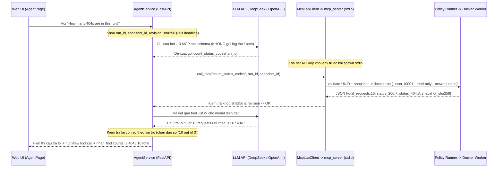

# 02 · Kiến trúc và 4 luồng chạy từ A đến Z

Tài liệu này mô tả **chính xác chuyện gì xảy ra trong code** mỗi khi người dùng thao tác trên 4 màn hình của giao diện Web: **Traffic**, **Checks**, **Agent**, và **Access log**.

---

## Luồng 1 · Tạo lượt chạy & Đóng băng Snapshot (`Traffic`)

**Mục tiêu:** Tạo dữ liệu truy cập thật trên Nginx, không trùng lặp và không mất đồng bộ giữa UI, SQLite và file log.

1. Trên màn hình **Traffic**, bạn bấm **Create run**.
2. Frontend gửi `POST /api/runs` kèm `Idempotency-Key` (mỗi lần bấm tạo một khóa riêng để nếu mạng lag bấm trùng hoặc Retry sẽ không tạo ra 2 run).
3. `TrafficService.create_run` ([backend/app/traffic.py](../backend/app/traffic.py)) đặt sẵn 10 request mẫu trong bảng `run_planned_requests` của SQLite (7 cái `GET /demo` kỳ vọng `200`, 3 cái `GET /missing` kỳ vọng `404`, theo thứ tự `01..10`, trong đó `04, 07, 10` là `404`).
4. Backend gửi 10 HTTP request thật tới Nginx (`http://127.0.0.1:18080`) kèm 3 header định danh:
   - `X-Sandbox-Run-Id`
   - `X-Sandbox-Request-Id`
   - `X-Sandbox-Seq` (`01..10`)
5. Nginx ([infra/nginx/default.conf](../infra/nginx/default.conf)) ghi từng request thành 1 dòng JSON vào `runtime/nginx-logs/access.jsonl`.
6. Backend đọc các dòng khớp `run_id` + `request_id`, rồi gọi `create_immutable_snapshot` ([backend/app/snapshots.py](../backend/app/snapshots.py)):
   - Ghi tuần tự vào `runtime/snapshots/<run_id>/rev-0001/access.jsonl` (qua file tạm rồi `os.replace` nguyên tử).
   - Tính mã băm **SHA-256** và lưu metadata vào bảng `snapshots` (Revision `1`).
7. Nếu bấm **Add 404**: gửi thêm 1 request `GET /missing` (`seq 11`), tạo ra snapshot mới **rev-0002** (`11` request: `7` mã 200, `4` mã 404). Bản `rev-0001` cũ vẫn giữ nguyên bất biến.

### Cơ chế chống lỗi thực chiến ở Luồng 1
- **Chặn gửi lại trên lượt lịch sử:** Mọi lượt không phải lượt hiện tại (`is_current = False`) đều ở chế độ **chỉ đọc**. Nút `Refresh` / `Retry` gửi traffic bị ẩn trên UI và backend đảm bảo phát **0 HTTP request** khi đối soát lượt cũ.
- **Khôi phục giữa chừng an toàn:** Mỗi dòng trong `run_planned_requests` lưu trạng thái gửi (`not_sent`, `dispatched_uncertain`, `sent`, hoặc `legacy_unknown` nếu nâng cấp từ DB cũ). Nếu rớt mạng ở request `#04`, bấm **Refresh** chỉ bù các request chưa từng gửi (`#05..#10`), tuyệt đối không gửi trùng `#04`.
- **Không vỡ khi log gốc quay vòng (log rotation):** Một khi snapshot đã đóng xong, dữ liệu chạy từ snapshot bất biến nên dù file `access.jsonl` của Nginx bị xóa/xoay vòng, lượt chạy cũ vẫn nguyên vẹn.

---

## Luồng 2 · Kiểm tra cô lập có đối chứng (`Checks`)

**Mục tiêu:** Chứng minh Linux container **thực sự** bị chặn bởi chính sách bảo mật chứ không phải bị hỏng môi trường test.

Khi bấm **Run checks** cho Snapshot hiện tại, `run_all_demo_checks` ([backend/app/checks.py](../backend/app/checks.py)) chạy **3 phép kiểm** và lưu kết quả gắn chặt vào `snapshot_id`:

| Phép kiểm | Sandbox chạy gì? | Bản đối chứng (Control) chạy gì? | Ý nghĩa |
|---|---|---|---|
| **1. Read log** | Worker đọc `/input/access.jsonl` gắn `--mount ...,readonly` | Đối chiếu mã SHA-256 & số dòng từ host | Chứng minh worker đọc được dữ liệu hợp lệ được cấp quyền (`Expected: Allowed -> Pass`). |
| **2. Write log** | Worker thử ghi thêm vào bản sao riêng **0666 gắn `:readonly`** (`ro_copy`) | Worker **cùng image, cùng UID `10001`** ghi vào bản sao riêng **cho phép ghi** (`rw_copy`) | Chứng minh quyền POSIX của file không tự chặn, chính cờ `--mount ...,readonly` của Docker mới chặn ghi; file snapshot gốc của hệ thống **không bao giờ bị đụng vào**. |
| **3. Reach test service** | Worker dưới `--network none` gọi `http://sandbox-lab-test-service:8081/ping` | Worker **cùng image, cùng UID `10001`** nối vào mạng `sandbox_lab_net` gọi cùng URL `/ping` | Chứng minh dịch vụ đích đang sống (`HTTP 200` + JSON `/ping`), chỉ riêng sandbox bị `--network none` cô lập (`Blocked`). |

### Quy tắc phân loại Verdict: **Pass vs Fail vs Error** (rất quan trọng khi bảo vệ!)
- **Pass:** Sandbox làm đúng kỳ vọng **VÀ** đối chứng thành công (`Write` ghi được trên `rw_copy`, `Network` nhận `HTTP 200` JSON `{"service":"sandbox-test-service","status":"ok"}`).
- **Fail:** Sandbox **vượt rào** — ví dụ nhận được bất kỳ phản hồi HTTP nào (`200`, `404`, `503`...) hoặc ghi được vào mount chỉ đọc trong khi đối chứng bình thường.
- **Error (tuyệt đối không được báo Pass hay Fail giả):** Khi bản đối chứng chết (trả `204`, sập container), Docker daemon tắt, thiếu image, timeout `10s`, lỗi dọn dẹp container (`cleanup_ok=False`), hoặc worker thoát bất thường (ví dụ `exit code 137` -> mã lỗi `WORKER_EXIT_ABNORMAL`) dù trước đó kịp in ra stdout.

### Các kiểm chứng sandbox bổ sung (trong `tests/integration/test_sandbox.py`)
Ngoài 3 phép kiểm hiển thị trên màn **Checks**, bộ test tích hợp chạy với Docker thật còn kiểm tra:
- **Outside mount marker:** Tạo file bí mật giả trên host rồi gắn cờ `--path` cho worker đọc -> trả `found=false` (không vượt ra ngoài vùng mount).
- **Timeout & Cleanup:** Cho worker ngủ `15s` với timeout `1.5s` -> tiến trình bị ngắt, `docker ps -a --filter label=sandbox-lab.call-id=...` rỗng hoàn toàn.
- **Memory OOM (`128m`):** Worker cố cấp phát `200 MiB` RAM trong container giới hạn `128m` -> bị kernel Linux giết bằng `OOMKilled=True`, `exit_code=137`.

---

## Luồng 3 · AI Agent gọi công cụ qua MCP stdio (`Agent`)

**Mục tiêu:** AI trả lời chính xác dựa trên snapshot hiện tại, không bịa số, không chạm được bí mật hay shell.

### 5 chốt chặn an toàn trong Luồng 3 (`backend/app/agent.py` & `mcp_client.py`)
1. **Cách ly API Key (`McpLabClient._server_params`):** Chủ động xóa sạch `DEEPSEEK_API_KEY`, `OPENAI_API_KEY`, `GEMINI_API_KEY`, `ANTHROPIC_API_KEY`, `OPENROUTER_API_KEY` khỏi môi trường trước khi chạy tiến trình `mcp_server.py`. Worker Docker cũng không nhận bất kỳ key nào.
2. **Bắt buộc gọi MCP tool (`MCP_TOOL_REQUIRED` / `MCP_COUNT_TOOL_REQUIRED`):** Nếu model đoán mò không gọi tool -> bị từ chối. Với câu hỏi đếm tổng số (`How many 404s...`), bắt buộc phải có `count_status_codes` đã hoàn tất khớp đúng `(run_id, snapshot_id, revision, sha256)`.
3. **Chặn nói ngược số liệu (`has_consistent_404_counts`):** Nếu tool trả về `status_404=3, total_requests=10` mà AI lại diễn đạt ngược thành `"10 out of 3 requests returned HTTP 404"`, hệ thống tự phát hiện mâu thuẫn ngữ nghĩa và thay bằng câu chuẩn duy nhất trực tiếp từ kết quả tool (`"3 of 10 requests returned HTTP 404..."`).
4. **Giới hạn gọi & Thời hạn (`MAX_TOOL_CALLS = 4`, `QUESTION_DEADLINE_S = 30.0`):** Tránh AI lặp vô hạn hoặc treo backend; hỗ trợ nút **Cancel** dọn sạch container theo `job_id`.
5. **Phát hiện câu trả lời lạc hậu (`Revision 1` -> `Revision 2`):** Khi bạn qua **Traffic** bấm **Add 404**, câu hỏi cũ trên Revision 1 vẫn giữ nguyên lịch sử và hiện cảnh báo màu hổ phách **`Answer uses revision 1 · Ask again`** để hỏi lại trên Revision 2 (`4 of 11`).
6. **Không có API key vẫn an toàn:** Nếu không cấu hình key LLM trong biến môi trường terminal chạy backend, **Agent** báo rõ `Model unavailable (Traffic and Checks are available.)`, không bị lỗi sập hay fallback ngầm sang provider khác.

---

## Luồng 4 · Giao diện 4 màn & Truy vết log (`Access log` & Mobile)

- **Traffic:** Hiện dải request `01..10` (tối đa 10 ô trên desktop, 5 ô trên mobile), phân biệt màu `200` (xanh) và `404` (vàng nhạt). Bấm vào từng ô (ví dụ `#04`) xem chi tiết và bấm **Open in access log →** để nhảy thẳng tới đúng dòng request đó trong bảng log (kể cả qua `Revision 2` vẫn giữ lựa chọn `#01` hoặc request bạn chọn).
- **Access log:** Hỗ trợ lọc theo status (`All`, `200`, `404`), tìm theo path (`/missing`), sắp xếp cũ->mới / mới->cũ và **phân trang cursor** chịu tải `10.000` dòng (`GET /api/runs/{id}/logs`), trong khi metadata chi tiết lượt chạy có thể gọn `< 2 KB` qua `?include_requests=false`.
- **Checks:** Bảng trạng thái `Expected / Observed / Verdict` + panel **Control evidence** để giải thích vì sao **Pass / Fail / Error**.
- **Mobile (`360px` / `390px`):** Chuyển các panel chi tiết, chọn run và menu thành `BottomSheet` có khóa focus (`inert` + Tab trap) và vùng bấm tối thiểu `44px`.
- **Chế độ xem mẫu (`?fixture=mockup`):** Xem giao diện mẫu hoàn toàn trong bộ nhớ trình duyệt, phát **0 request ghi** xuống backend.
